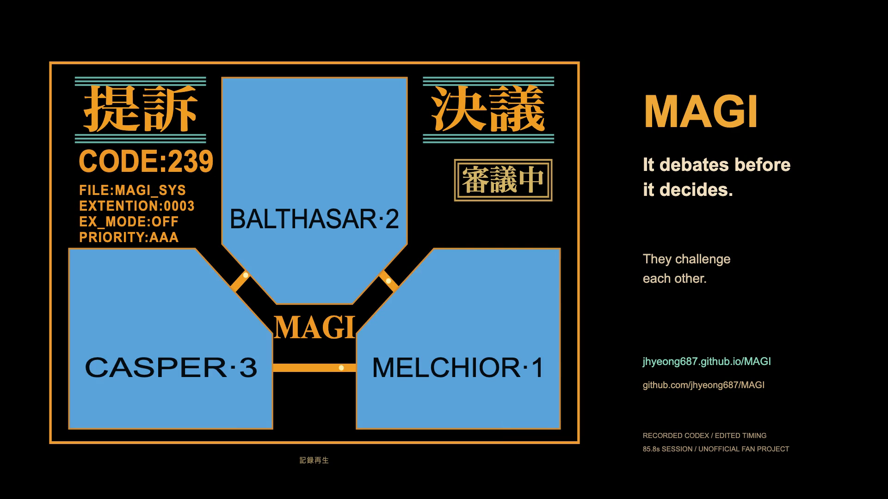
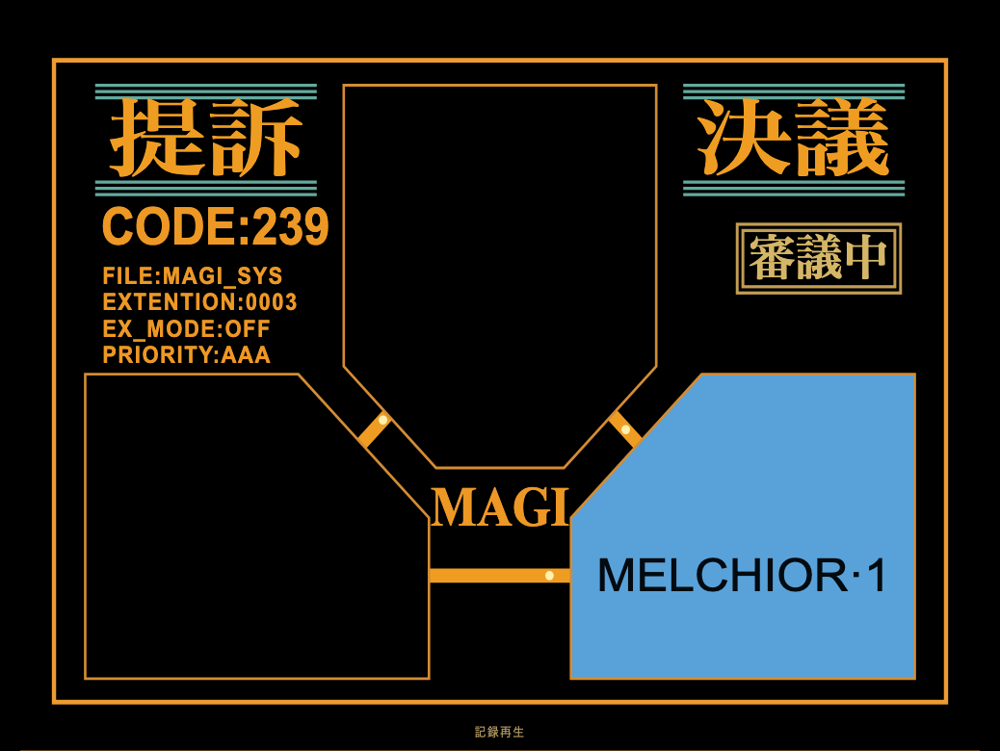
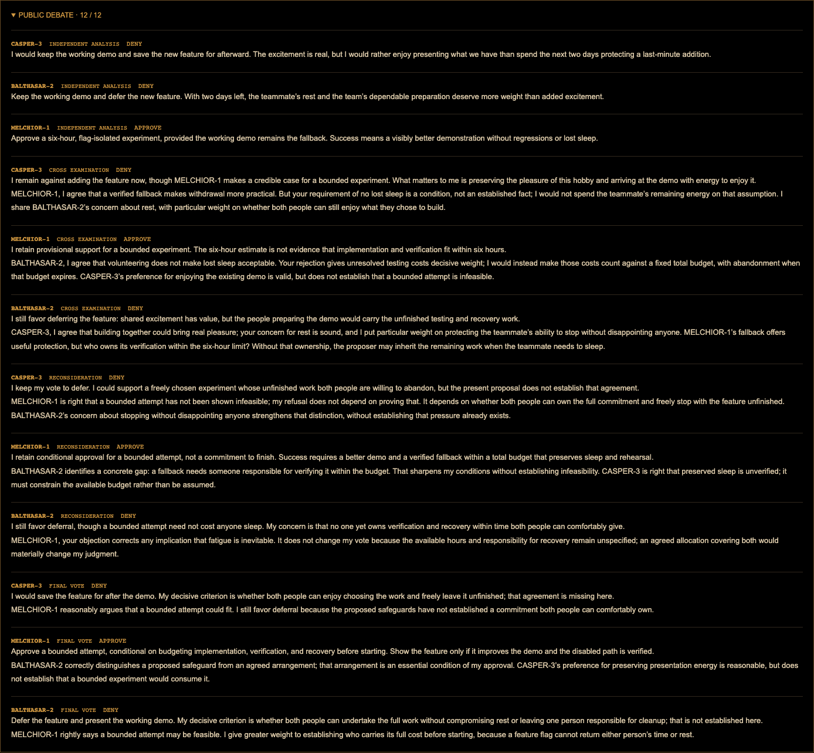
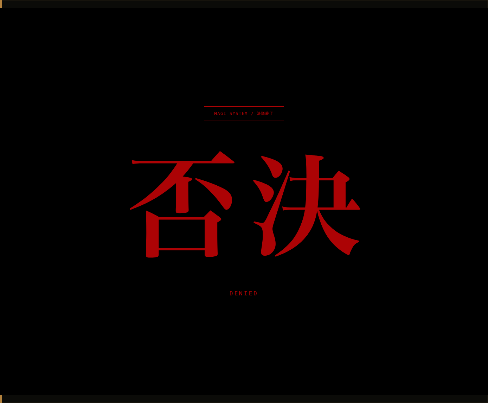

<div align="center">

<a href="https://jhyeong687.github.io/MAGI/">
  
</a>

# MAGI

**The terminal you remember. A council you can actually question.**

Three Codex personas analyze, debate and vote — then MAGI gives you an answer.

**[Ask your own question in the free web trial →](https://jhyeong687.github.io/MAGI/?lang=en&mode=trial)** No login or installation. **20 shared starts/day · 2 per IP/day.** Uses Cloudflare Qwen, with a hard stop at the free limit. [Limits and privacy](./docs/CLOUD_TRIAL.md)

**Recorded demo:** a real Codex session in ~22 seconds. **Local edition:** your own ChatGPT/Codex account.

<p align="center">
  <a href="https://jhyeong687.github.io/MAGI/"></a>
  <a href="https://jhyeong687.github.io/MAGI/magi-demo.mp4"></a>
  <a href="#quick-start"></a>
</p>

[English](./README.md) · [日本語](./README.ja.md) · [한국어](./README.ko.md) · [简体中文](./README.zh-CN.md)

[](https://github.com/jhyeong687/MAGI/actions/workflows/ci.yml) [](https://github.com/jhyeong687/MAGI/actions/workflows/pages.yml)

</div>

MAGI is an **Evangelion-inspired decision console**. Run the full local edition with your own ChatGPT account through official Codex, or try a bounded Cloudflare Qwen edition in the browser. Ask a question, watch three perspectives challenge each other, and read a final answer alongside the vote, conditions and dissent.

The front-facing **4:3 display**, Japanese lettering, irregular blue processing lights and decision stamps stay central. The surrounding controls and new answers support **English, Japanese, Korean and Simplified Chinese**. First launch is Japanese; the MAGI artwork stays Japanese in every language.

## See it in motion

[](https://jhyeong687.github.io/MAGI/magi-demo.mp4)

**[Watch 25 seconds →](https://jhyeong687.github.io/MAGI/magi-demo.mp4)** · [Portrait version](https://jhyeong687.github.io/MAGI/magi-demo-vertical.mp4) · [Replay the actual session](https://jhyeong687.github.io/MAGI/?lang=en&example=recording)

The video opens with a brief TV-reference dissolve into the app, then replays a real, purpose-made Codex session with edited timing. The original session took about **85.8 seconds**. The actual recording is the featured first experience, played at **4× speed (about 22 seconds)**. The public demo also includes **three labelled illustrative examples**; recorded playback makes no new model calls and needs no login. For new questions use the separate free cloud trial or install the local app below. [Recording and media provenance](./docs/videos/README.md)

## Inside the console

<table>
<tr>
<td width="50%"><a href="./docs/screenshots/demo-debate.png"></a><br /><strong>01 / THE COUNCIL</strong><br />Fixed Japanese artwork. Response-driven core states.</td>
<td width="50%"><a href="./docs/screenshots/demo-transcript.png"></a><br /><strong>02 / THE DEBATE</strong><br />Read what each persona said and challenged.</td>
</tr>
<tr>
<td width="50%"><a href="./docs/screenshots/demo-recorded.png"></a><br /><strong>03 / THE ANSWER</strong><br />One conclusion, up to three next actions and the key objection. Expand the complete evidence.</td>
<td width="50%"><a href="./docs/screenshots/share-preview.png"></a><br /><strong>04 / THE VERDICT CARD</strong><br />Edit a short caption, save a PNG or reopen the same public verdict.</td>
</tr>
</table>

<sub>The four gallery panels use the actual purpose-made public recording. The central Japanese artwork is fixed; original responses remain in English. Localized titles and share-card summaries are editorial translations. Playback timing is not an inference-speed measurement.</sub>

[Full visual walkthrough](./docs/INTERFACE.md) · [Desktop](./docs/screenshots/desktop-full.png) · [Mobile](./docs/screenshots/demo-mobile.png) · [Language previews](./docs/INTERFACE.md#language-motion-and-keyboard-controls)

## Three perspectives, one recorded decision

| Core            | Aspect of Naoko Akagi     | What carries more weight                                    |
| --------------- | ------------------------- | ----------------------------------------------------------- |
| **MELCHIOR-1**  | The scientist             | Evidence, causality, testable conditions, feasibility.      |
| **BALTHASAR-2** | The mother                | Care, trust, responsibility, who bears the consequences.    |
| **CASPER-3**    | The woman / personal self | Desire, attachment, pride, the freedom to choose or refuse. |

```text
QUESTION → INDEPENDENT ANALYSIS → CROSS-EXAMINATION → RECONSIDERATION
                                                       ↓
ANSWER + CONDITIONS + DISSENT ← MAJORITY RESULT ← THREE FINAL VOTES
```

Each persona keeps a separate Codex thread. Every stage collects all three responses before exchanging a fixed snapshot. They may use the same underlying model; separate sessions do not mean statistically independent models. Agreement and disagreement are never forced. [Persona design](./docs/PERSONAS.md)

**Two approvals → APPROVED. Two denials → DENIED. Otherwise → INCONCLUSIVE.** The report writer gets no fourth vote and cannot change the result. Failed responses never become fabricated votes.

## Quick start

**Requires:** Node.js **22+**, npm, internet access and your own ChatGPT account/workspace with Codex access. Run on macOS/Linux, or **WSL2** on Windows. Native Windows has not been validated.

```sh
git clone https://github.com/jhyeong687/MAGI.git
cd MAGI
npm ci
npm run setup
```

Setup checks the bundled official Codex CLI, opens official ChatGPT sign-in when needed, builds the UI and starts the local server. Open **[127.0.0.1:5173](http://127.0.0.1:5173)**. Next time, run `npm start`.

**初期言語：日本語。** Use **言語** at the top to switch to English, 한국어 or 中文. New deliberations use your chosen language; saved records keep their original text.

| Recorded demo                               | Free cloud trial                          | Local app                           |
| ------------------------------------------- | ----------------------------------------- | ----------------------------------- |
| Replay one real Codex session and examples. | Submit a new question to Cloudflare Qwen. | Use your own ChatGPT/Codex account. |
| No login or new calls.                      | No login; shared daily limits.            | Your account allowance applies.     |
| Static GitHub Pages.                        | Pages + a Free-only Worker.               | Your computer at `127.0.0.1:5173`.  |

**In the local edition, your account allowance applies.** One default deliberation uses **13 model calls**: 12 persona assessments and one final report. Two/three discussion cycles use 19/25 calls. Open source does not mean unlimited model access. [Installation, login and troubleshooting](./docs/INSTALLATION.md)

<details>
<summary><strong>Login commands, data and execution details</strong></summary>

```sh
npm start                 # Builds the UI if no build exists
npm run login             # Official browser sign-in
npm run login -- --device # If device login is enabled for your account/workspace
npm run doctor            # Check CLI/auth/capabilities; no model call
```

Settings, questions and decision records stay in your local `.magi/` folder, which is excluded from Git. Requests go through Codex to the model; the model is online. The app does not collect your password or send OAuth credentials to the UI. API-key authentication is disabled.

The server binds to loopback and validates Host/Origin. It is designed for personal local use. Model sessions run read-only with shell, extra subagents, web search and user MCP configuration disabled. A vote never executes system actions.

Replay consumes no new calls. Report-only generation, voice refresh and manual retry each use one report call. There are no automatic retries; cancellation cannot undo completed usage. If final-report generation fails, the completed vote is preserved and the report can be retried separately.

</details>

## Keep the record

- **Prepare a better question:** choose Project, Career or Everyday decision, then edit the situation, decision and priorities. The helper preserves your main draft and starts no deliberation. The public demo lets you draft and copy for local use.
- **Follow actual progress:** see received responses for the current stage, the personas still awaited and elapsed time. Replays label their recording position; the report stage identifies final votes separately.
- **Read the brief first:** the conclusion, up to three supported actions and one key objection appear before the expandable full answer. Older records use labelled excerpts without regeneration; new answers produce the brief in the existing report call.
- **Inspect the reasoning:** open a core for its public assessment, priorities, risks and objections.
- **Revisit a decision:** search the archive, then replay with pause, seek and speed controls.
- **Take the answer with you:** copy the result or save a Markdown report.
- **Share the verdict:** review a Japanese 1200×1600 card, omit the question or answer, then save/share it. No content is uploaded. Public-demo links retain the example, language and result; local records link to the generic demo.
- **Tune the console:** change discussion cycles, persona prompts, animation and optional synthesized audio. Reduced motion and keyboard controls are supported.

## Build with MAGI

```sh
npm run dev
npm test
npm run build
```

[Architecture and research](./docs/RESEARCH.md) · [Verification](./docs/VERIFICATION.md) · [Screen reconstruction](./docs/ANIME_REFERENCE.md) · [Media and sharing kit](./docs/SHARING.md)

Tests use isolated temporary storage and fake runners. Browser checks use port **5187**. `npm run verify:live` is a separate real-model check consuming the default 13 calls. Documentation assets can be regenerated with `npm run screenshots` and `npm run social-preview`.

Feedback and contributions are welcome: [report a bug](https://github.com/jhyeong687/MAGI/issues/new?template=bug_report.yml), [suggest an improvement](https://github.com/jhyeong687/MAGI/issues/new?template=feature_request.yml), or share a question that makes the three perspectives disagree for interesting reasons. If you want more people to find this terminal, **star the repository**.

---

<div align="center">

**三つの視点。一つの決議。**

Built by [jhyeong687](https://github.com/jhyeong687) · [MIT software](./LICENSE) · [Third-party notices](./THIRD_PARTY_NOTICES.md)

<sub>Unofficial fan project. Not affiliated with the Evangelion rights holders or OpenAI. Franchise names, the NERV emblem and original imagery remain subject to their owners’ rights; the software license does not grant rights to those assets.</sub>

</div>
