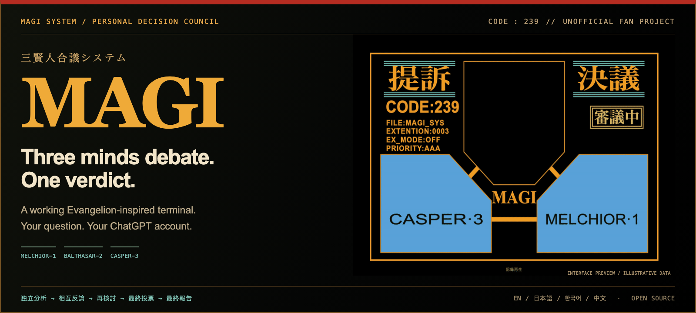

# MAGI — 三人格合议终端

[](https://jhyeong687.github.io/MAGI/)

**三种视角展开讨论，由 MAGI 给出最终决议。使用你自己的 ChatGPT 账户运行，非官方同人项目。**

[English](./README.md) · [한국어](./README.ko.md) · [日本語](./README.ja.md)

**[▶ 公开演示 — 无需登录](https://jhyeong687.github.io/MAGI/)** · [25秒演示视频](https://jhyeong687.github.io/MAGI/magi-demo.mp4) · [↓ 开始使用](#开始使用)

**[免费提交自己的问题 →](https://jhyeong687.github.io/MAGI/?lang=zh&mode=trial)** 无需安装或登录，使用Cloudflare Qwen进行真实审议。**所有访客每天最多20次，同一IP每天2次，同时最多2项。** 达到免费限额即停止，不切换至付费模型或运营者的Codex。[限制、隐私与部署说明](./docs/CLOUD_TRIAL.md)

原有公开记录回放约22秒的实际Codex审议。本地完整版仍使用自己的ChatGPT与Codex账户。

## 公开演示、视频与分享

[公开交互演示](https://jhyeong687.github.io/MAGI/)无需安装或登录，明确区分三个说明用示例和一次为公开展示而运行的实际Codex审议。实际记录保留英文原文，并已移除私人会话标识和账户用量。MAGI主画面始终保留日语。

[25秒横版视频](./docs/videos/magi-demo.mp4) · [竖版视频](./docs/videos/magi-demo-vertical.mp4)。开头从TV参考画面叠化为本项目，再播放经过时间剪辑的实际审议记录。

完成答复后，点击 **分享决议** 预览图片，选择是否包含问题和答复，再保存PNG。支持的浏览器也提供原生图片分享。私人内容不会上传。自己的问题可通过免费云端体验，或本地版与自己的账户运行。

实际审议作为默认推荐体验，以4倍速、约22秒回放；原审议约85.8秒。公开决议分享链接会打开同一提案、语言和结果。

## 开始使用

问题助手提供 **项目 / 职业与学业 / 日常选择** 示例，可编辑情况、需要判断的选择和重要条件。保留原草稿，不会自动执行。公开演示仅提供草稿编写与复制。处理时显示当前阶段实际收到的应答数、等待的人格和已用时间。答复先展示 **简短结论 → 最多三项行动 → 主要异议**，完整依据可展开。既有记录从保存内容摘录，无需重新生成。

需要 Node.js 22 及以上、npm、互联网连接，以及具有 Codex 使用权限的个人 ChatGPT 账户或工作区。支持 macOS/Linux；Windows 用户请在 WSL2 中运行。

```sh
git clone https://github.com/jhyeong687/MAGI.git
cd MAGI
npm ci
npm run setup
```

项目包含官方 Codex CLI。尚未登录时会打开官方登录页面；登录后自动构建并启动本地服务。打开 [http://127.0.0.1:5173](http://127.0.0.1:5173)。之后使用 `npm start` 即可。也可以先启动应用，再点击“使用 CHATGPT 登录”。

## 切换语言

默认使用日语。在页面顶部选择 **言語 → 中文**，即可切换到简体中文。提供 English / 한국어 / 日本語 / 中文四种语言。菜单、处理提示和登录提示随之切换，新的审议也将使用所选语言。已保存的问题与答复保留原文，不会被自动翻译或覆盖。

## 实际处理流程

三个独立的 Codex 会话依次执行：独立分析 → 相互质询 → 重新审视 → 最终投票。至少两票赞成则通过，至少两票反对则否决，其余情况暂缓判断。随后依据实际讨论和固定投票结果，生成直接答复、条件和剩余分歧。

- MELCHIOR-1：科学家的侧面，注重证据、因果与可行条件。
- BALTHASAR-2：母亲的侧面，注重照顾、关系与责任。
- CASPER-3：女性与个人的侧面，注重欲望、依恋与自主选择。

界面提供正面4:3显示、固定诊断面板、不规则处理闪烁、公开讨论、历史搜索、无需新调用的回放，以及答复复制与报告保存。为保留原作氛围，MAGI 画面内的「提訴」「決議」、状态印、决议演出及系统铭文始终保持日语，其他菜单与答复随所选语言切换。三个会话可能使用相同的基础模型，不代表三个统计独立的模型。

本地版默认每次审议使用 **13次调用**，计入自己的账户额度。免费云端版同样最多13次调用，但使用另一种Qwen模型，输出更短，且有共享的每日限额。

图片与 GIF 使用说明用示例数据，并非实际模型输出或推理速度测量。[界面指南](./docs/INTERFACE.md) · [English documentation](./README.md) · [MIT](./LICENSE) · [第三方声明](./THIRD_PARTY_NOTICES.md)
