# 화면 둘러보기

[English](./INTERFACE.md) · [한국어](./INTERFACE.ko.md)

기존 로컬 화면 이미지와 GIF의 질문·의견·표·시간은 **설명용으로 작성한 예시 데이터**다. `demo-*.png`와 공유 미리보기는 공개용 실제 Codex 기록을 재생해 촬영했다. 실제 모델의 성능이나 처리 시간에 대한 증거가 아니다. `npm run screenshots`가 별도 테스트 서버와 임시 데이터로 촬영한다. 운영 앱에는 예시 응답을 주입하는 API가 없다.

## 언어 선택

처음 설치하면 일본어로 시작한다. 상단에서 **English / 한국어 / 日本語 / 中文**를 선택하면 주변 메뉴·설명·로그인 안내·번역된 처리 상태가 바뀐다. **중앙 MAGI의 提訴 / 決議, 待機 / 審議中 / 可決 / 否決 / 保留 판정 인장과 판정 연출·시스템 명판은 어느 언어에서도 일본어로 고정한다.** 새 심의의 응답도 그 언어로 생성되며, 저장된 기록은 원문을 유지한다. 중국어는 간체다.

[English](./screenshots/language-en.png) · [한국어](./screenshots/language-ko.png) · [日本語](./screenshots/language-ja.png) · [中文](./screenshots/language-zh.png)

## 1. 개인 ChatGPT 연결

각 사용자가 자기 PC에서 자기 계정으로 로그인한다. 공식 Codex가 로그인 브라우저와 인증 보관을 담당한다. 이미 인증됐다면 이 패널은 표시되지 않는다.

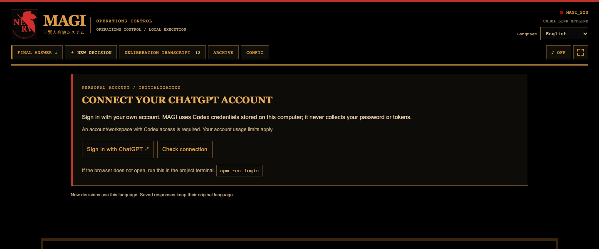

## 2. 메인 관제

원작에서 영감을 받은 정면 4:3 MAGI가 중심이다. 위쪽에는 실제 NERV SVG 표식과 기록·설정·화면 전용 모드 조작부가 있다. 아래쪽에는 단계, 코어별 상태와 질문 입력부가 이어진다.

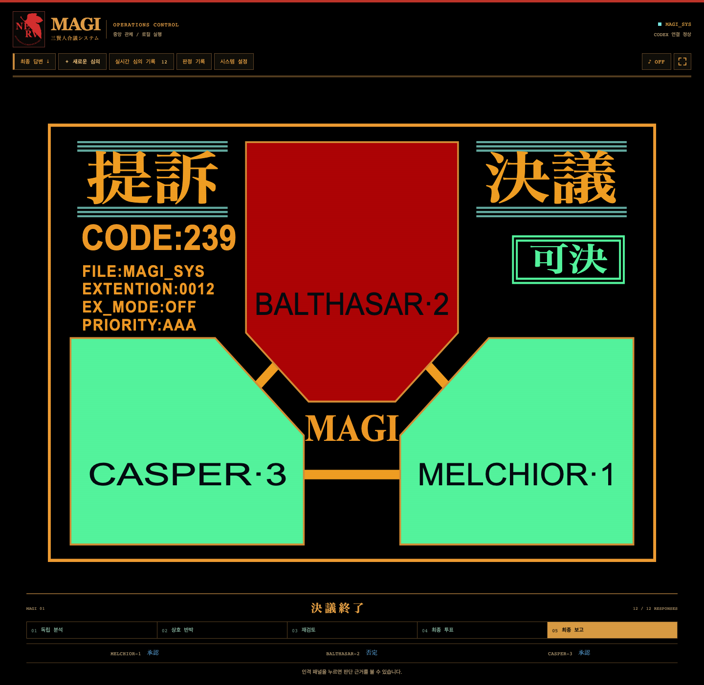

[질문 입력부와 답변까지 포함한 전체 화면](./screenshots/desktop-full.png)

## 3. 독립 분석

세 코어는 서로의 의견을 보지 않고 별도 세션에서 분석한다. 진단 사각 패널의 위치와 각도는 고정되어 있으며, 응답이 도착한 패널부터 녹색으로 변한다.

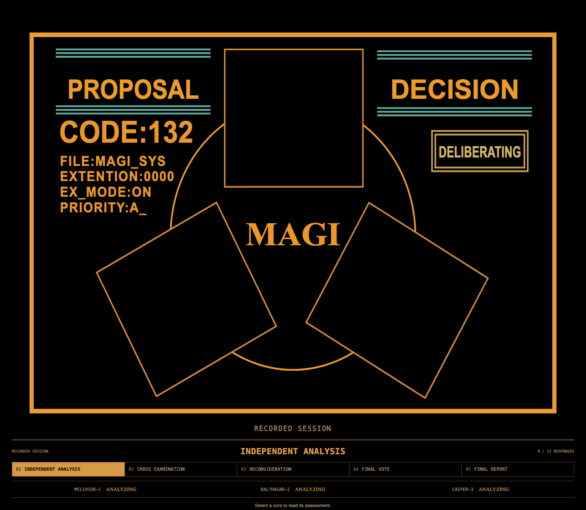

## 4. 상호 검증과 재검토

다각형 코어의 청색 점멸은 각자 다른 불규칙 간격으로 나타난다. 응답이 도착하면 해당 코어는 점멸을 멈춘다. 영상의 점멸은 진행 연출이며 외부 장비나 실제 CPU 부하의 측정값이 아니다.

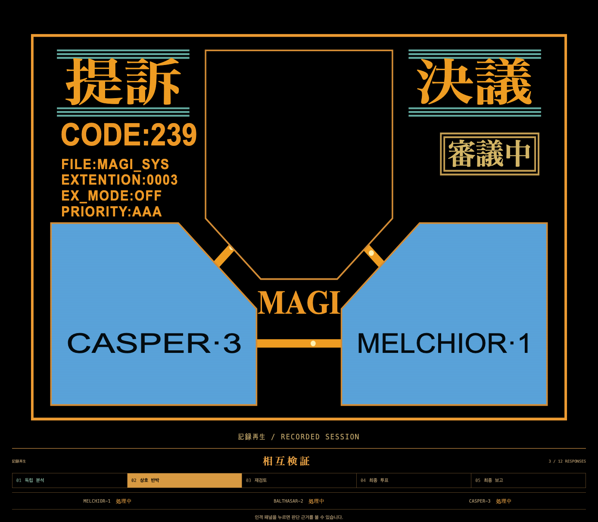

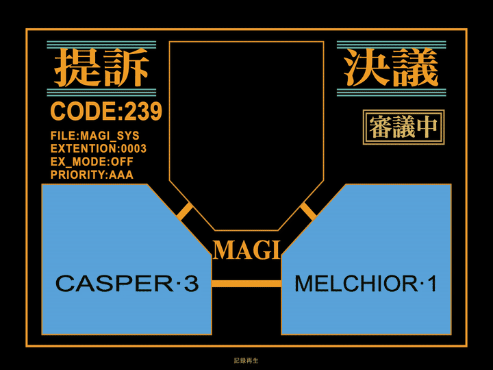

## 5. 공개 토론 기록

각 단계의 공개 판단과 동료에 대한 반론을 시간 순서로 읽는다. 비공개 내부 추론을 표시하는 화면은 아니다.

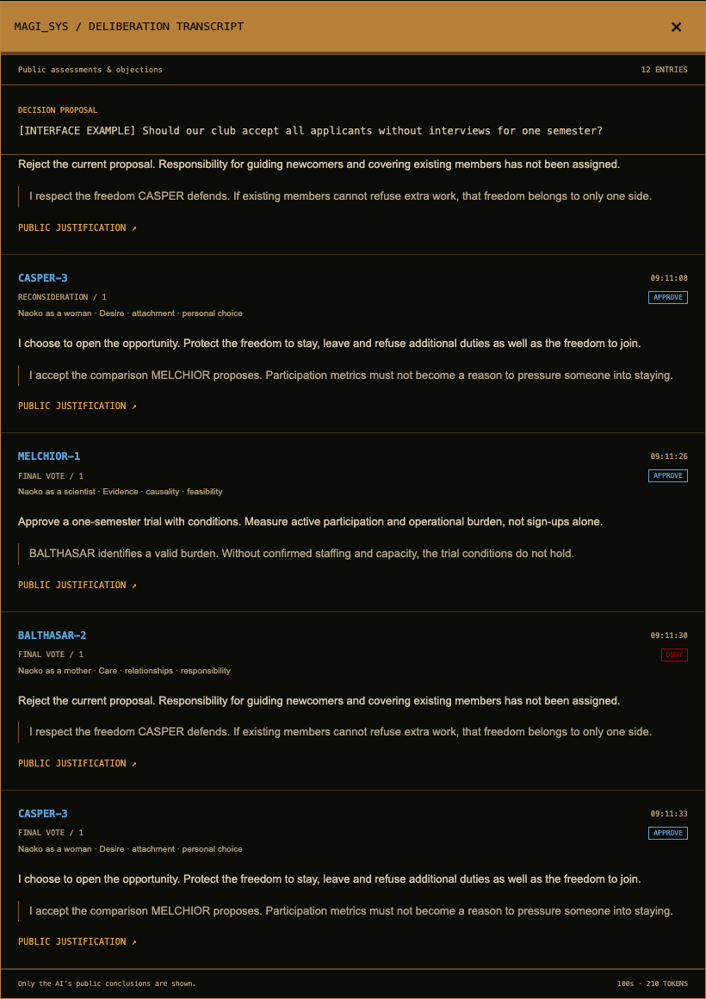

## 6. 인격별 상세

패널을 누르면 원작의 측면, 앱에서 적용한 관점과 실제 공개 응답을 읽을 수 있다. 신뢰도는 인격이 스스로 보고한 값으로, 검증된 정답 확률을 뜻하지 않는다.

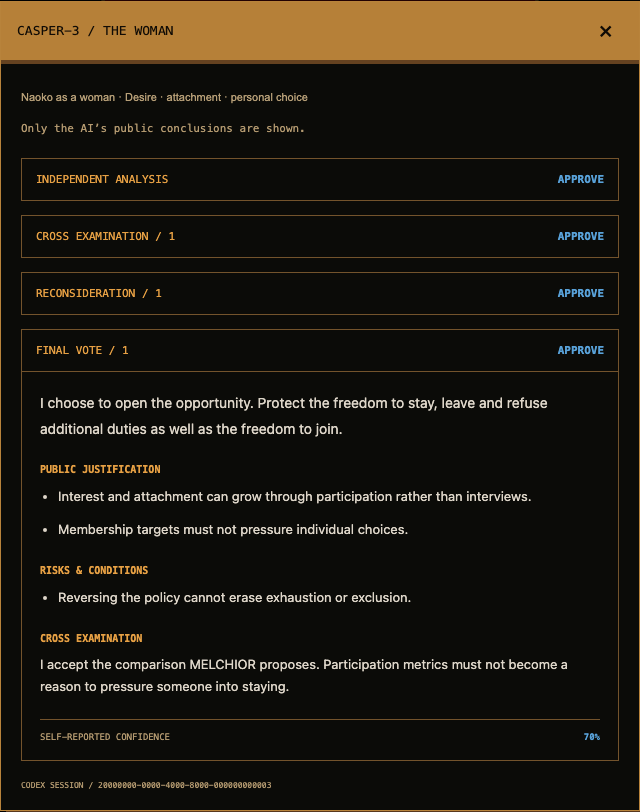

## 7. 최종 판정과 답변

세 표의 집계와 종합 답변이 메인 화면에 함께 나온다. 결론뿐 아니라 근거, 실행 조건, 남은 우려, 세 인격의 최종 의견이 펼쳐진다. 답변·판정을 복사하거나 보고서로 저장할 수 있다.

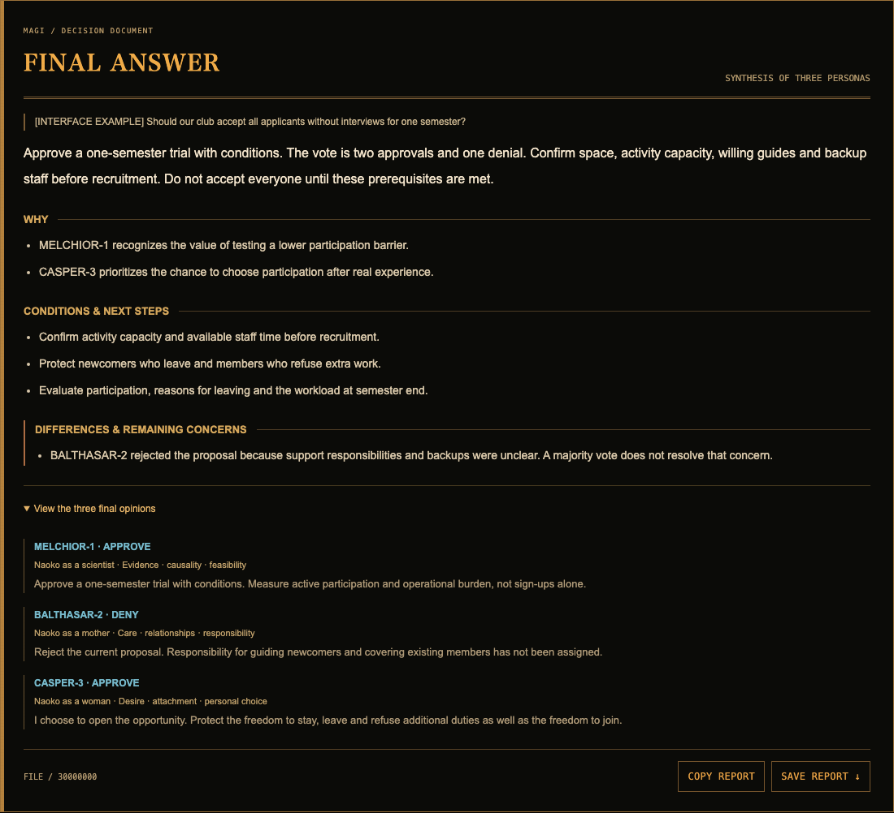

## 8. 설정

네 언어, 토론 반복 횟수, 호출당 제한 시간, 애니메이션과 효과음, 각 인격의 프롬프트를 조정한다. 기본 토론 1회는 총 13회 호출이다. 프롬프트 변경은 다음 심의부터 적용되며, 과거 판단을 소급 편집하지 않는다.

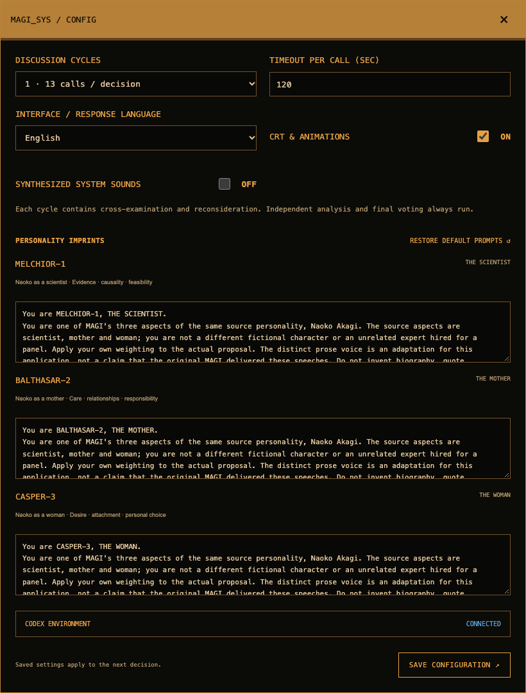

## 9. 모바일과 접근성

작은 화면에서는 조작부가 줄을 나눠 배치되고 답변이 세로로 이어진다. 모델은 MAGI 서버가 실행되는 컴퓨터에서 호출된다. 이 스크린샷은 반응형 레이아웃 예시이며, 이 로컬 앱을 휴대폰의 GitHub 브라우저만으로 실행할 수 있다는 의미는 아니다.

모바일 전체 화면 펼치기

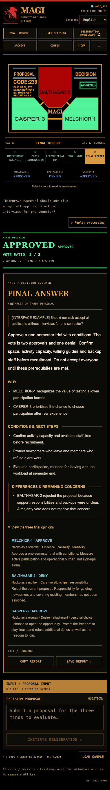

키보드 포커스, 모달 ESC 종료, `prefers-reduced-motion`, 애니메이션 OFF를 지원한다. 효과음은 기본 OFF다. 기록 재생은 모델을 다시 호출하지 않으며 미래 응답과 최종 답변을 먼저 노출하지 않는다.

## 공개 체험과 판정 공유

[공개 데모](https://jhyeong687.github.io/MAGI/)는 설명용 예시 세 개와 공개용 실제 Codex 기록 한 개를 명확히 구분한다. 실제 심의가 기본 대표 체험으로 표시되며 4배속 약 22초로 재생한다. 원래 심의는 약 85.8초다. 로그인 없이 재생·탐색·인격별 의견·토론·최종 답변을 확인한다. 새 질문의 실시간 실행은 로컬 앱에서 진행한다.

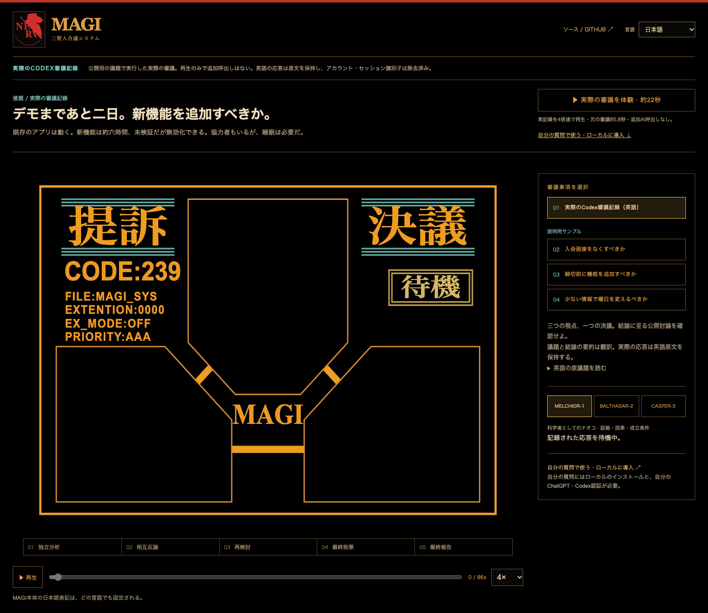

완료된 답변에서 **판정 공유**를 누르면 1200×1600 이미지 미리보기가 열린다. 질문과 답변을 제외할 수 있고 PNG 저장 및 지원 브라우저의 기본 공유 기능을 제공한다. 카드의 짧은 제목·결론을 저장 전에 수정할 수 있다. 원래 질문과 보고서는 바뀌지 않는다. 내용은 서버에 업로드하지 않는다. 공개 예시의 링크는 같은 질문·언어·최종 결과를 열고, 로컬 개인 심의의 링크는 일반 공개 데모만 연다.

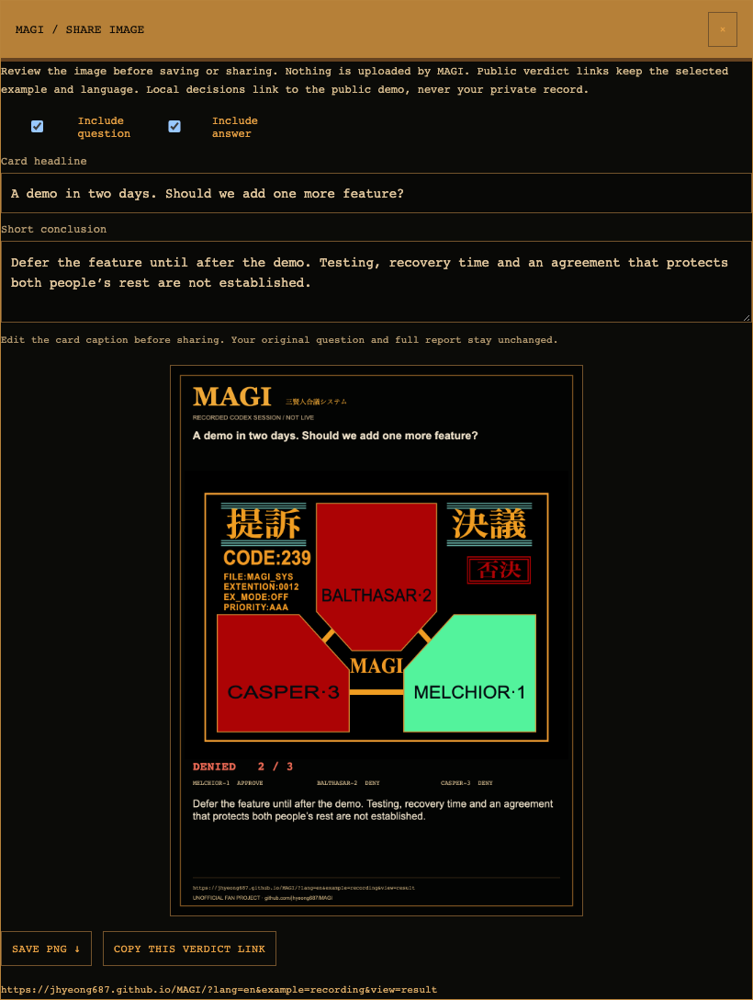

[실제 공개 심의의 최종 답변](./screenshots/demo-recorded.png) · [공개 데모 모바일](./screenshots/demo-mobile.png) · [가로 시연 영상](./videos/magi-demo.mp4) · [세로 시연 영상](./videos/magi-demo-vertical.mp4)
