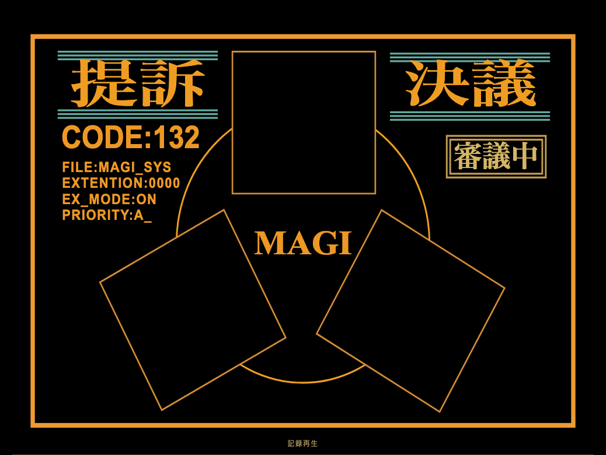

# Inside the MAGI console

[English](./INTERFACE.md) · [한국어](./INTERFACE.ko.md) · [Installation](./INSTALLATION.md) · [Try the public demo](https://jhyeong687.github.io/MAGI/)

The central **4:3, front-facing MAGI display** keeps its Japanese lettering and original-inspired atmosphere in every language. Controls, help and new local deliberations support English, Japanese, Korean and Simplified Chinese. Fresh installations start in Japanese; select **言語 → English** at the top to switch.

The new public-demo images below use a purpose-made **actual Codex recording**. Its original English opinions and final answer are preserved; localized titles and card summaries are editorial translations. The recording took about 85.8 seconds and starts at 4× playback speed, about 22 seconds. Other legacy gallery images use authored documentation examples. [Complete provenance](./screenshots/README.md)

## Start with a real recorded session

The public demo highlights the actual recording first. A labelled start button appears above the console on desktop and mobile. It replays the existing recording without login or new model calls. Three separately labelled illustrative examples cover approval, denial and no-majority outcomes.

[English interface](./screenshots/demo-english.png) · [Mobile first screen](./screenshots/demo-mobile.png)

## Independent analysis

Each core analyzes the question before seeing the others' assessments. Diagnostic panels remain still. Core states change when recorded responses arrive; blue processing pulses are an interface effect, not a measurement of CPU activity.

## Cross-examination and reconsideration

Select a persona to read its latest public assessment and response to the others. Expand **Public debate** for the complete chronological public transcript. This is not a display of private internal reasoning.

## Final vote and answer

MELCHIOR approves with conditions, while BALTHASAR and CASPER deny the public demonstration proposal. The recorded result is **2–1 DENIED**; no conflict or vote was forced. **Show final answer** ends playback, plays the Japanese decision reveal, then moves keyboard focus and the viewport to the answer. Natural completion also brings the answer into view.

The report preserves the result, reasons, next steps and remaining differences. The report writer does not cast a fourth vote.

## Share a verdict

Open **Share verdict** after an answer. Review the Japanese **1200×1600** card, edit its short headline and conclusion, or exclude either before saving a PNG. This changes the card caption only; the original question and full report remain unchanged. Supported browsers also provide native image sharing.

Public-demo links reopen the same public example, selected language and result. Local decisions link to the generic public demo; private questions, answers and run identifiers never go into those links. MAGI uploads no card content.

## Ask your own question locally

The public site is replay-only. **Ask your own question · install locally** leads to installation instructions and the [English installation/troubleshooting guide](./INSTALLATION.md). Each person uses their own computer and ChatGPT/Codex account. Official Codex handles sign-in and credential storage.

A default new deliberation uses **13 calls** against the signed-in account's allowance. The local app also offers a searchable archive, replay, copy/report export, persona details and configurable discussion cycles, prompts and effects.

[Local desktop](./screenshots/desktop-full.png) · [Persona detail](./screenshots/persona.png) · [Settings](./screenshots/settings.png)

## Language, motion and keyboard controls

The MAGI artwork always keeps **提訴 / 決議 / 待機 / 審議中 / 可決 / 否決 / 保留**, including the final reveal. Switching the surrounding language does not translate saved records. Chinese UI uses Simplified Chinese.

The console maintains its 4:3 ratio at small sizes. The primary start and playback controls retain text labels and touch targets. The app supports visible keyboard focus, Escape to close dialogs, reduced motion and animations OFF. Synthesized audio is optional and OFF by default.
